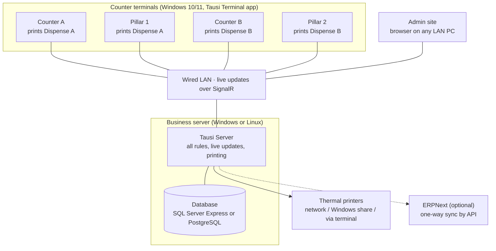
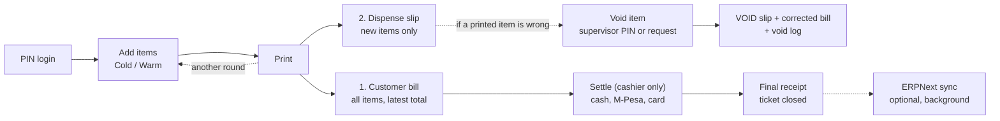

# Tausi POS — Design

Last updated: 19 Oct 2026

Tausi POS is a restaurant and bar POS **product** by **NexaGen Solutions**, built on .NET, React and Tauri. It runs on each customer's own server and terminals. Mau's Village is the first customer.

- **Coding rules:** `AGENTS.md` in the repo root.
- **Screens:** `docs/wireframes/` (PDF).

## Overview

Tausi POS is sold to bars and restaurants, and each business gets its own install:

- a **server** (Windows or Linux) that holds the data, rules and printing
- a full-screen **Tausi Terminal** app on each counter

It must run the whole business on its own, covering sales, stock and basic accounting. ERPNext is an optional link for later.

**In this version**

- First-run setup wizard (business name, logo, VAT, first admin) and a licence key
- PIN login, live table map, ordering with Cold/Warm options
- One **Print** button: the full customer bill first, then only new items to the dispense printer. The **server prints directly**.
- Void, gift, reprint and price changes controlled by a **role permission grid**
- Supervisor approvals on the PIN pad, or from the supervisor's own counter
- Only the cashier settles:
    - cash, recording **who brought it**
    - M-Pesa, with the code typed in
    - card
    - split payments
- Receipts that list all items and show **Total includes VAT**
- Cash-ups for cashiers and waiters
- **Stock:** stock items, recipes, suppliers, deliveries, stock counts with variance
- **Basic accounting:** cash book, expenses and a daily profit summary, on a double-entry ledger
- Reports with export to Excel
- Admin site for menu, prices, stock, staff, permissions, terminals, printers and settings

**Not in this version**

- KRA eTIMS (planned next; VAT is stored on every sale so it can plug in)
- M-Pesa STK integration
- Phone ordering, kitchen display screens
- Payroll, balance sheet, multiple warehouses

ERPNext integration is optional and can be switched on later without changing the POS.

## At a glance

Everything runs on the business's own machines and LAN, so service doesn't need the internet. ERPNext, if added, only receives copies of the sales in the background.

## Components

| Part | Runs on | Built with | What it does |
| --- | --- | --- | --- |
| **Tausi Server** | The business's server PC, as a Windows service or Linux (systemd) service | .NET 10 (LTS), ASP.NET Core, SignalR, EF Core | All business rules: tickets, printing, voids, permissions, settling, stock, ledger, reports. Prints to the printers directly and pushes live updates to every terminal. |
| **Database** | Same server | SQL Server Express (Windows) or PostgreSQL (Linux and dev); one EF Core model | Menu, tables, tickets, payments, stock, ledger, users, logs. |
| **Tausi Terminal** | Each counter PC (Windows 10/11) | Tauri v2 shell + the React UI | Full-screen, starts with Windows, knows which terminal it is, updates itself. Prints to a local USB printer when a printer is set to "via terminal". |
| **Admin site** | Any PC on the LAN, in a browser | The same React UI, served by Tausi Server | Menu, prices, stock, deliveries, cash book, staff, permissions, terminals, printers, reports, settings. |

The terminal app and admin site share one React codebase. Development happens on Ubuntu, where the server and UI run; GitHub Actions builds the Windows terminal installer.

## Data

The main tables:

| Area | Tables |
| --- | --- |
| **Business** | BusinessSettings (name, logo, address, VAT rate, currency, rounding, receipt footer, print mode), Licence |
| **People** | Users (name, role, hashed PIN), Roles, RolePermissions (role × permission → Allowed / Needs approval / Not allowed) |
| **Devices** | Terminals, Printers (connection: network IP / Windows share / via terminal; paper width; template) |
| **Menu** | Categories, MenuItems (price incl. VAT, VAT rate), ModifierGroups, ModifierOptions, Recipes (menu item → stock item + quantity), PriceChangeLog |
| **Service** | Tables, WorkPeriods, Shifts, Tickets, Orders (added by, terminal, status, printed-at), Bills (bill number per print), ApprovalRequests, VoidLog |
| **Money** | Payments (type, amount, VAT, M-Pesa code, **taken by** cashier, **brought by** waiter), CashUps (expected vs counted) |
| **Stock** | StockItems (unit, cost, reorder level), Suppliers, Deliveries + lines, StockMovements (sale, delivery, waste, adjustment), StockCounts + lines |
| **Accounts** | LedgerAccounts (Cash, M-Pesa, Bank, Card clearing, Sales, VAT payable, Stock, Cost of sales, Stock loss, Expenses, Supplier payables, Rounding), JournalEntries + lines, Expenses |
| **System** | PrintJobs, AuditLog, IdempotencyRecords, ErpSync (optional) |

Every sale, delivery, expense and stock change writes balanced journal lines automatically. Staff never see the ledger, but totals always add up, and a future ERPNext link can send clean entries.

Every order line records who added it and on which terminal. The server enforces this, so the blank `*` user seen in SambaPOS cannot happen.

## How an order flows

1. **Log in and pick a table.** The waiter logs in with their PIN and taps a table. It turns blue on every terminal.
2. **Add items and press Print.** One button does both jobs, in this order:
    1. The **customer bill** prints with **all items** on the ticket and the current total.
    2. The **dispense slip** prints with **only the items added since the last Print**, so the counter pours just those.

    The first Print sends every item to the counter. Each later round prints a full updated bill ("Bill 3 · replaces earlier bills") plus a slip with just the new items. Pressing Print with nothing new counts as a **reprint**, which follows the Reprint permission.
3. **Void if needed.** A wrong printed item is voided with approval: a supervisor PIN on the spot, or a request the supervisor approves from their own counter. A VOID slip prints at the counter, the corrected bill reprints automatically, and the void is logged. Whether waiters can void or reprint without approval is set in Permissions.
4. **Settle.** The waiter brings the cash or the M-Pesa message to the cashier. Only the cashier settles, recording who brought the cash, and the final receipt prints.
5. **Optional ERPNext copy.** If the sync is on, a copy of the sale goes to ERPNext in the background.

This one-button mode is the default. A setting switches a business to separate **Send** (new items to the counter) and **Print bill** buttons if they prefer.

## Printing

- **The server prints directly** by default, so printing never depends on a terminal app being open.
- **Each Print prints the bill first, then the dispense slip.** When one printer does both, as at Mau's, a paper cut separates them.
- **Connection mode,** set per printer in Settings:
    - **Network:** ESC/POS over TCP port 9100.
    - **Windows share:** a printer shared from a counter PC, when the server runs on Windows.
    - **Via terminal:** the server sends the job to that counter's terminal app, which prints to its USB printer. This is the fallback.
- **Routing is per terminal:** at Mau's, Counter A and Pillar 1 → Dispense A; Counter B and Pillar 2 → Dispense B.
- **Slips:**
    - **Customer bill:** all items, numbered ("Bill 2 · replaces earlier bills"), "Total includes VAT"
    - **Dispense slip:** only items not yet printed
    - **VOID slip**
    - **Final receipt** on settle
    - **Cash-up slip**
- **Failures:** failed prints are queued, retried, and shown on screen as "Not printed · Retry". The Terminals page shows each printer's status.

## Roles and approvals

Permissions are a **grid of roles × actions** in Settings. Each cell is **Allowed**, **Needs approval** (supervisor PIN or request) or **Not allowed**. The server checks every action, not just the buttons. The defaults for a new business:

| Action | Waiter | Cashier | Supervisor | Admin |
| --- | --- | --- | --- | --- |
| Open tables, add orders, move and merge | Allowed | Allowed | Allowed | Allowed |
| Cancel an item not yet printed | Allowed | Allowed | Allowed | Allowed |
| Print (bill, then new items to the counter) | Allowed | Allowed | Allowed | Allowed |
| Void a printed item | Needs approval | Needs approval | Allowed | Allowed |
| Gift or discount | Not allowed | Needs approval | Allowed | Allowed |
| Reprint bill | Needs approval | Allowed | Allowed | Allowed |
| Change a price on a ticket | Not allowed | Not allowed | Needs approval | Allowed |
| **Settle and take payment** | **Not allowed** | Allowed | Allowed | Allowed |
| Edit menu prices | Not allowed | Not allowed | Not allowed | Allowed |
| Receive deliveries, record waste | Not allowed | Not allowed | Allowed | Allowed |
| Stock counts and adjustments | Not allowed | Not allowed | Needs approval | Allowed |
| Expenses | Not allowed | Allowed | Allowed | Allowed |
| Cash book | Not allowed | Not allowed | Allowed | Allowed |
| See own sales | Allowed | Allowed | Allowed | Allowed |
| See all reports, open and close the day | Not allowed | Not allowed | Allowed | Allowed |
| Add staff and PINs | Not allowed | Not allowed | Allowed (waiter and cashier only) | Allowed |
| Permissions, terminals, printers, settings | Not allowed | Not allowed | Not allowed | Allowed |

Approvals happen on the same screen with a supervisor PIN, or as a request that appears on the supervisor's own counter. Every approval, price change and permission change is written to the AuditLog with who asked, who approved and when.

## Cash flow and cash-up

How money moves at Mau's Village:

1. The waiter takes the bill to the table. The customer pays by **M-Pesa** to the till, or in **cash** to the waiter.
2. The waiter brings the cash or the M-Pesa message to the cashier. **Only the cashier settles.**
3. On settle, the cashier records:
    - the payment type and amount
    - the M-Pesa code
    - **who brought it** (defaults to the table's waiter)
4. **Cashier cash-up at shift end.**
    - The system shows the expected cash: opening float + cash settled − expenses paid from the drawer − cash dropped to the safe.
    - The cashier counts by denomination and the difference is recorded.
    - A supervisor signs it off.
5. **Waiter check.** Each waiter sees their tables, what was settled, and any **bills still open on their name**, so unpaid or missing cash shows up the same night.

## Stock and basic accounting

- **Stock items vs menu items.** A menu item is what you sell; a stock item is what you buy and count. A recipe links them, e.g. 1 Tusker Lager = 1 bottle; 1 Viceroy Tot = 25 ml of a 375 ml bottle.
- **Every sale deducts stock** through its recipe. Voids put stock back only if the item was never served (a setting; the supervisor ticks "not served").
- **Deliveries** record the supplier, items, quantities and cost. They add stock and record what you owe the supplier, or a payment if paid on delivery.
- **Waste and breakages** are recorded with a reason.
- **Stock counts** compare expected with counted, showing the variance in units and KSh and who counted. Approving a count posts the variance as stock loss. This is the main loss control.
- **Expenses and cash book** cover expenses paid from the drawer or bank, cash banked, and supplier payments.
- **Daily summary** shows sales, VAT, net sales, cost of sales, gross profit, expenses and net for the day.
- All of this posts balanced journal entries to the ledger automatically.

## VAT and receipts

- **Prices include VAT.** Menu prices are entered including VAT. The VAT rate is set in Settings (16% by default) and can be changed per item, e.g. for exempt items.
- **Per-line VAT.** Each order line stores gross, net and VAT, ready for eTIMS later. VAT = gross × rate ÷ (100 + rate), rounded half away from zero to 2 decimals.
- **Receipt contents:**
    - business name, logo and address
    - ticket and table
    - all items and the total
    - **"Total includes VAT 16%: KSh X"**
    - payments and change
    - the footer
- **Rounding.** Totals on receipts and reports round to the nearest shilling by default. The rounding rule is a setting, and any rounding difference is stored as its own line.

## Reports

All reports run in the admin site, filter by date or work period, and export to Excel. Names are never cut off.

| Report | Shows |
| --- | --- |
| **Sales by User** | Total per user, then items with ticket no., time, qty and amount, grouped by user. Sales can be credited to who added the item or who opened the ticket. |
| **Payments and Cash-ups** | Per cashier: cash, M-Pesa and card taken, expected vs counted cash. Per waiter: cash brought in, bills still open. |
| **Voids, Gifts and Approvals** | What, how many, why, who asked, who approved, when |
| **Price Changes** | Menu and on-ticket price changes: old, new, who, when |
| **Stock on Hand** | Each stock item: quantity, value, below reorder level |
| **Stock Variance** | Last count: expected vs counted per item, in units and KSh, who counted |
| **Purchases** | Deliveries by supplier, amounts owed and paid |
| **Daily Summary** | Sales, VAT, cost of sales, gross profit, expenses, net |
| **Users, Roles and Terminals** | Each user, their role, terminals used, ticket counts |
| **My Sales** | On the terminal: the logged-in user's own figures, printable |

## Optional: ERPNext integration

Tausi POS works fully on its own. To use ERPNext for accounting and stock later, switch on the **ERPNext Sync** module. The POS screens don't change. The sync is **one-way and runs in the background**, so ERPNext being slow or offline never stops service.

| Direction | What | When |
| --- | --- | --- |
| ERPNext → POS | Items, item groups, prices | On demand ("Pull menu" in admin), or nightly |
| POS → ERPNext | Each settled ticket as a **Sales Invoice** (or POS Invoice) with items and payments | A few seconds after settle, by a background worker |
| POS → ERPNext | Day totals at work-period close (optional: one summary invoice instead of one per ticket) | On close |

How it works:

- **Authentication:** it uses ERPNext's standard REST API (`/api/resource/...`) with an **API key and secret** for a dedicated ERPNext user, stored encrypted in the POS settings.
- **Tracking:** each settled ticket gets a row in **ErpSync**: `Pending` → `Sent` (with the ERPNext invoice no.) or `Failed` (with the error). Failed rows retry automatically, and admins see a sync status page.
- **No duplicates:** each invoice carries the POS ticket no. as a unique reference, so a retry never creates a duplicate.
- **Mapping:** each POS product stores its ERPNext **item code**, and payment types map to ERPNext **Modes of Payment** (Cash, M-Pesa, Card).
- **Where ERPNext runs:** on a cloud server or a Linux machine on site. The POS only needs to reach it when syncing.

## Installation, backups and updates

**Server** (POSSERVER2 at Mau's Village)

- One installer sets up the Tausi Server as a Windows service (or a systemd service on Linux), and creates the `TausiPOS` database on SQL Server Express or PostgreSQL.
- Give the server a fixed IP and allow the service's port in the firewall. Turn off power saving on its network adapter.

**Terminals**

- Use one installer per terminal. On first start, an admin pairs it with the server and picks which terminal it is.
- The app starts with Windows, full screen.
- Terminals need **Windows 10 or 11**. At Mau's, Pillar 2 (Windows 7) must be upgraded or replaced.

**Backups**

- A nightly database backup is scheduled automatically.
- The backup file is copied off the server, to a USB drive or cloud folder, so it survives the server failing.

**Updates**

- The server is updated after closing time.
- The terminal app checks for a newer version when it starts and updates itself.

**Running alongside SambaPOS**

- Both can run on the same server at once, with separate databases.
- Trial one terminal first, then move counter by counter.

## Product setup and licensing

- **One install per business.** Each customer has their own server and database, and nothing is shared between customers.
- **First-run wizard:**
    1. Business name, logo, address and VAT.
    2. The first admin and PIN.
    3. Terminals and printers, with a test print.
    4. Import the menu (CSV or SambaPOS export).
    5. Opening stock count.
    6. Licence key.
- **Licence key** is tied to the business, with a set number of terminals. If it expires, sales keep working for a grace period, so service is never cut off.
- **Remote support:** an opt-in support mode, and a "Send diagnostics" button that bundles the logs.

## Development environment

- **Develop on Ubuntu.** Run the .NET server, PostgreSQL (or SQL Server in Docker) and the React UI there, and run the Tauri terminal with `npm run tauri dev`.
- **Build on GitHub Actions.** It builds the Windows terminal installer (Tauri, on a Windows runner) and the server packages for Windows and Linux.
- **Test on real hardware early.** Use a Windows counter PC and a real thermal printer from the first printing task.
- **Build order** (one prompt per step, each approved before the next):
    1. Foundation
    2. PIN login
    3. Staff and PINs
    4. Menu and prices
    5. Terminals and printers
    6. Table map
    7. Order screen + Cold/Warm + Print
    8. Void + approvals
    9. Settle
    10. My sales + cash-up
    11. Permissions + settings
    12. Stock, deliveries, counts
    13. Cash book + daily summary
    14. Reports
    15. Setup wizard
    16. ERPNext sync

## Later versions

These are left out of version 1, but the design leaves room for them:

- **M-Pesa STK:** a payment provider plugged into settle. The Payments table already stores the reference.
- **KRA eTIMS:** best handled through ERPNext once the sync is on, or as a direct module. VAT per line is already stored.
- **Phone ordering for waiters:** the same React UI on a phone layout, talking to the same server.
- **Kitchen display:** a screen that subscribes to the same live updates instead of printing.
