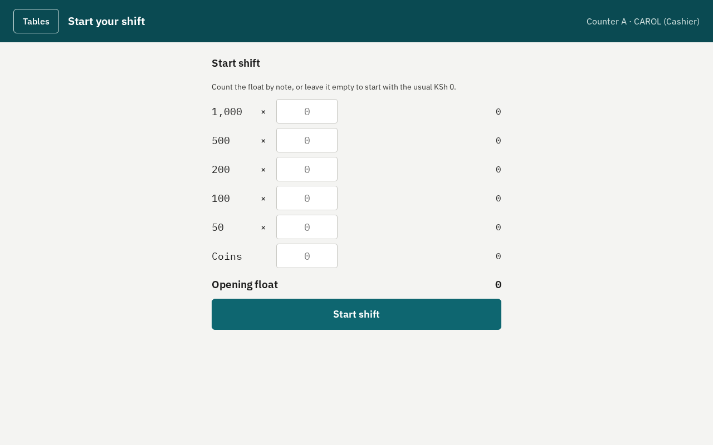
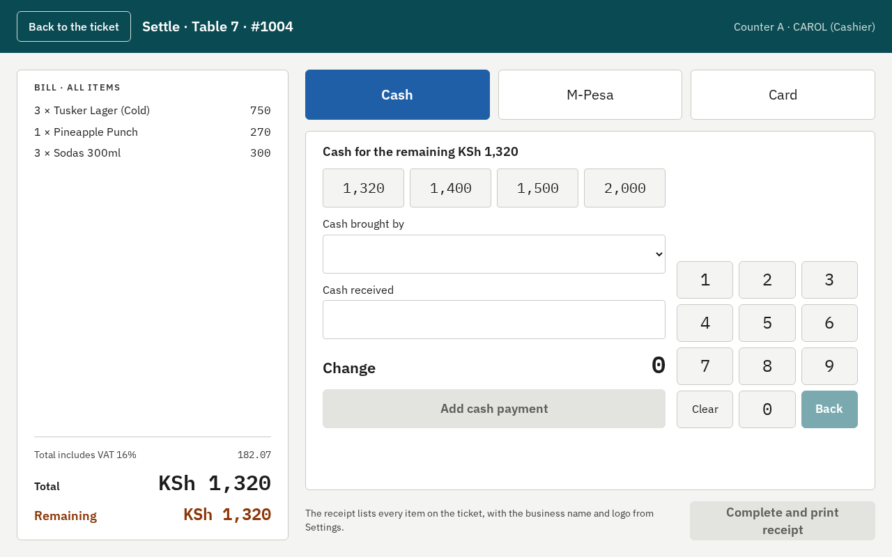
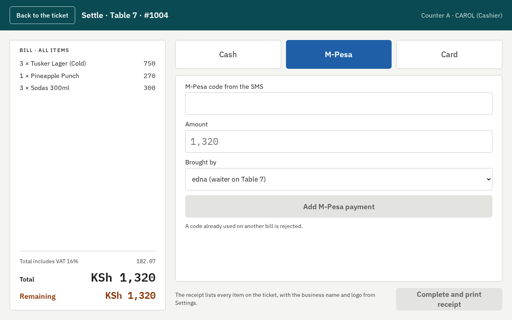
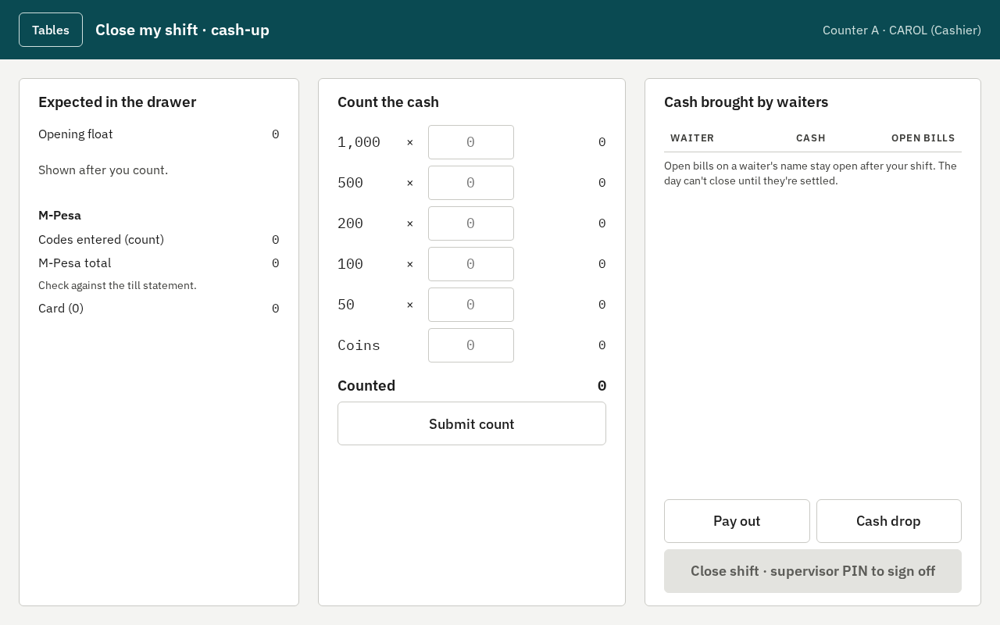

# Cashier guide

Tausi POS at `[BUSINESS NAME]`. Only cashiers (and supervisors) settle bills.

## 1. Start your shift

Log in with your PIN, press **My shift**, count the opening float into the drawer, type it, and press
**Start shift**. You can't take money until your shift is started.

## 2. Settle a bill

Open the table (tap it on the map, or use **Settled** to find closed ones), then press **Settle**. The
bill on the left lists every item and the VAT included.

**Cash**

1. Choose **Cash**. Tap a quick amount (the exact total, or the note the customer gave), or type it.
2. **Brought by**: the waiter who brought the money (the table's waiter is filled in).
3. The **change** shows. Press **Add cash payment**.

**M-Pesa**

1. Choose **M-Pesa**. Type the **code from the SMS** exactly; a code already used on another bill is
   refused.
2. Check the amount and who brought it, then **Add M-Pesa payment**.

**Card**: choose **Card**, type the terminal's reference if there is one, then add it.

**Split payment**: add the payments one after another (for example 1,000 cash, then the rest by
M-Pesa). **Remaining** shows what is still due.

When **Remaining** is 0, press **Complete and print receipt**. The receipt prints and the table is free.

## 3. Reprint a receipt

Open **Settled** on the table map and press **Reprint receipt** on the ticket.

## 4. Pay outs and cash drops

On **My shift**:

- **Pay out**: money taken from the drawer to pay for something (choose what it was for and add a
  note). It may need a supervisor's PIN.
- **Cash drop**: cash moved from the drawer to the safe during the shift.

Both lower the cash expected in the drawer.

## 5. Close your shift (cash-up)

1. **My shift** → count the drawer **by note and coin** and press **Submit count**. The expected amount
   is shown only after you count, so the count is honest.
2. Any difference shows. Check the M-Pesa total against the till statement.
3. **Close shift**: a supervisor types their PIN to sign it off. Your cash-up slip prints.

Bills still open on a waiter's name stay open after your shift; the day can't close until they are
settled.

## If something goes wrong

- **"Not connected"**: wait; it comes back by itself. Don't take the payment twice: when it is back,
  check the ticket's payments before adding one.
- **A wrong payment** before you completed: remove it from the list and add the right one.
