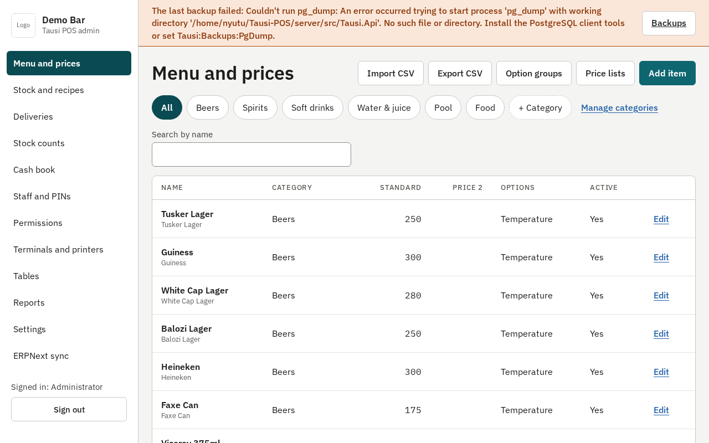
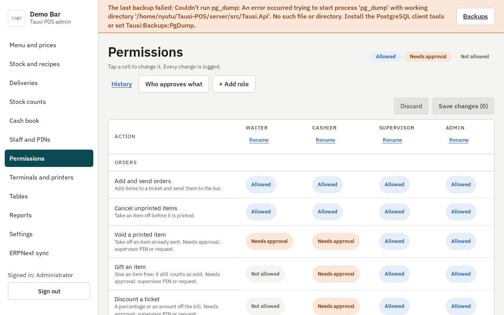
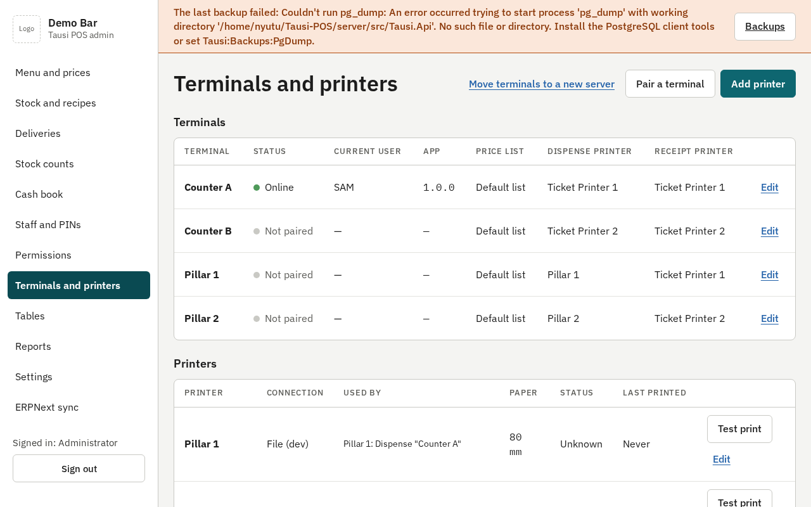
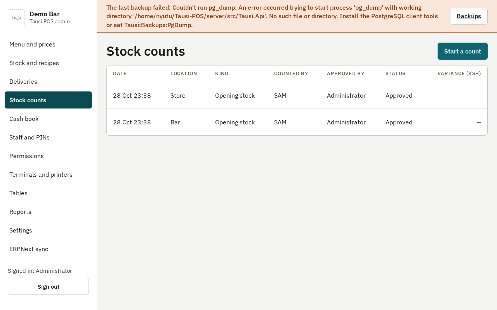
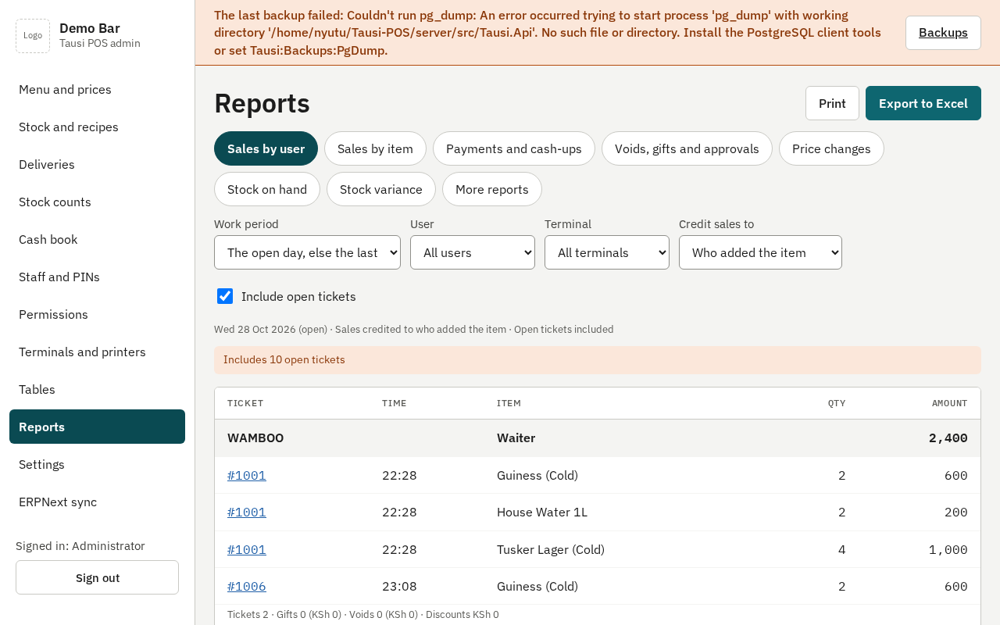
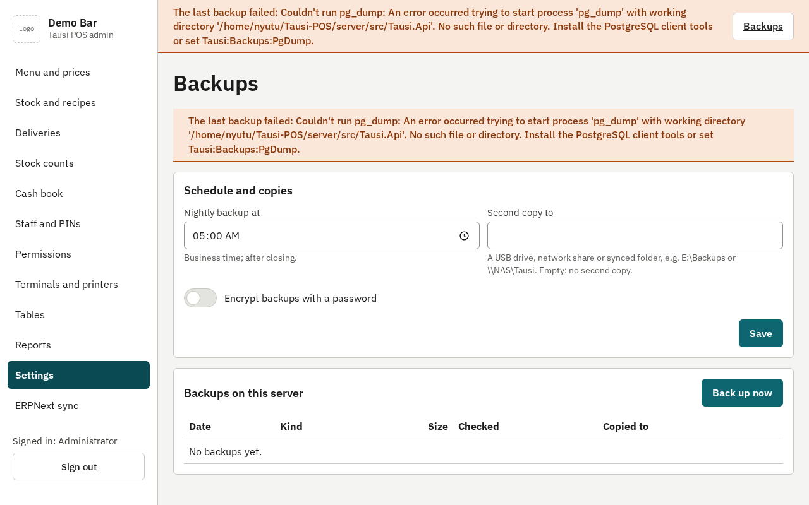
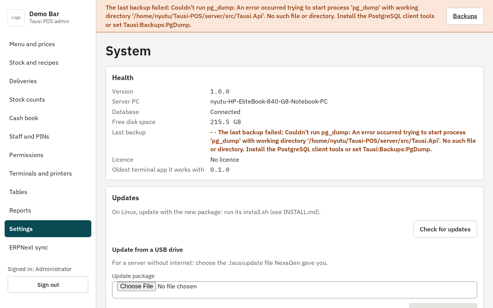
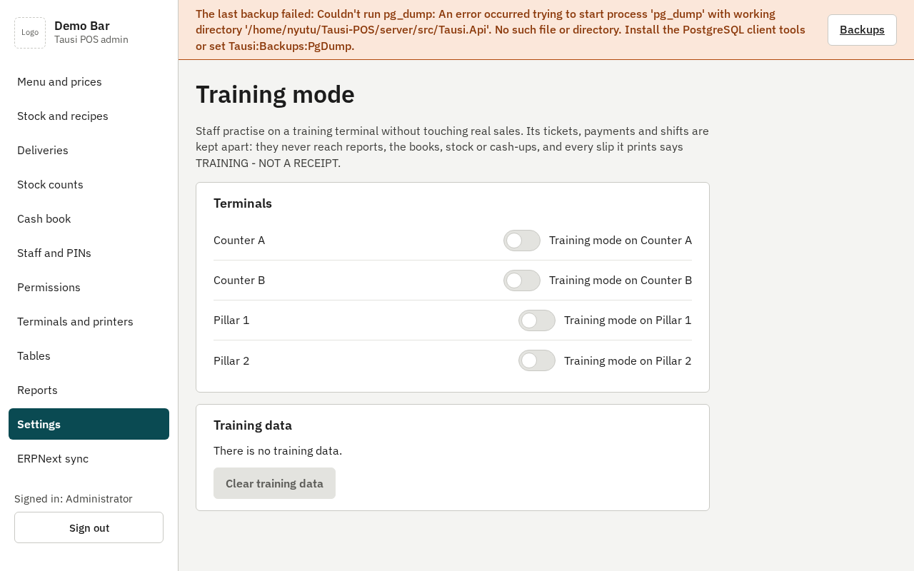

# Owner and admin guide

Tausi POS at `[BUSINESS NAME]`. The admin site is the back office: on the server PC open **Tausi POS
Admin** (desktop or Start menu), or on any PC on the bar's network open `http://[SERVER IP]:5080/admin`
and sign in with your admin user name and password.

## Menu and prices

**Menu and prices**: categories on the left, items on the right. Add or edit an item's name, price (VAT
included), category, choices (such as Cold / Warm) and recipe. Price lists let one terminal sell at
another price (for example a VIP bar). Every price change is recorded (Reports → Price changes).
Terminals show the change within seconds.

## Staff and PINs

**Staff and PINs**: add a person with their role and a starting PIN. They choose their own PIN at their
first login. **Reset PIN** logs them out everywhere at once; **Deactivate** stops them at once. Give
admin-site passwords only to managers.

## Permissions

**Permissions**: a grid of roles × actions. Each cell is **Allowed**, **Needs approval** (a supervisor's
PIN or request) or **Not allowed**. The server checks every action, whatever the screens show. Every
change is audited.

## Terminals and printers

**Terminals and printers**: each counter PC, its status and app version, and which printers it uses
(the dispense slip and the receipt). **Pair a terminal** adds a new counter PC (type the code its screen
shows). **Add printer** for a network printer (its IP), a printer shared from a Windows PC, or one plugged
into a terminal; press **Test print**. Failed jobs can be sent to another printer.

## Stock

- **Deliveries**: record what a supplier brought (items, quantities, cost), paid now or owed.
- **Stock and recipes**: each stock item with its unit, cost and reorder level; transfers between the
  Store and the Bar; waste with a reason.
- **Stock counts**: count what is on the shelves (the expected figures show only after you submit).
  Approving the count records the variance in units and shillings as stock loss.

Every sale takes stock out through its recipe when it prints.

## The cash book

**Cash book**: expenses paid from the drawer or the bank, cash banked, and supplier payments, with the
daily summary (sales, VAT, cost of sales, gross profit, expenses, net). Everything posts to the books
automatically and always balances.

## Reports

**Reports**: sales by user or item, payments and cash-ups, voids and approvals, price changes, stock on
hand and variance, purchases, the daily summary, VAT, tickets, users and terminals, and the audit log.
Choose the day or the dates, then **Print** or **Export to Excel**.

## Settings

**Settings**: the business name, logo, address, VAT rate and receipt footer, and the rules (one Print
button, approvals from the supervisor's counter, who brought the cash, M-Pesa code, idle log-out).
From there:

- **Backups**: a backup runs **every night** and is checked (**Verified**). Set a **second copy** (a USB
  drive or a network folder) so it survives the server failing. **Back up now** before big changes.
  A red banner means a backup failed: fix it the same day.

  

- **Licence**: the licence's state, terminals in use, and **Enter licence key** for a new key from
  NexaGen. If it lapses, sales keep working during the grace period.

- **System**: the version and health. **Check for updates** and install after closing time (or from a
  USB drive); terminals update themselves afterwards. **Download diagnostics** when NexaGen support asks
  for it.

  

- **Training mode**: switch a terminal to training for new staff (an orange band; nothing counts), and
  **Clear training data** afterwards.

  

## Every morning

Backup **Verified** (no red banner) · no failed prints · yesterday's day closed and every cash-up signed
off · all terminals online.
