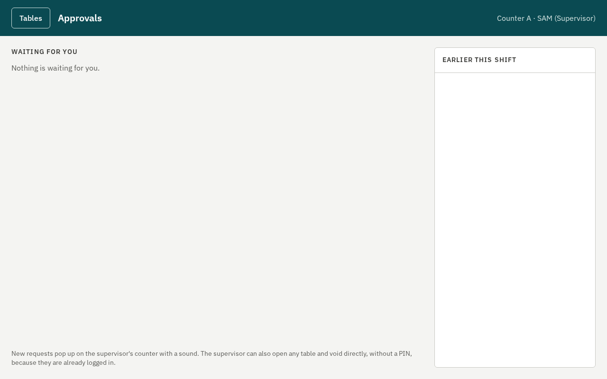
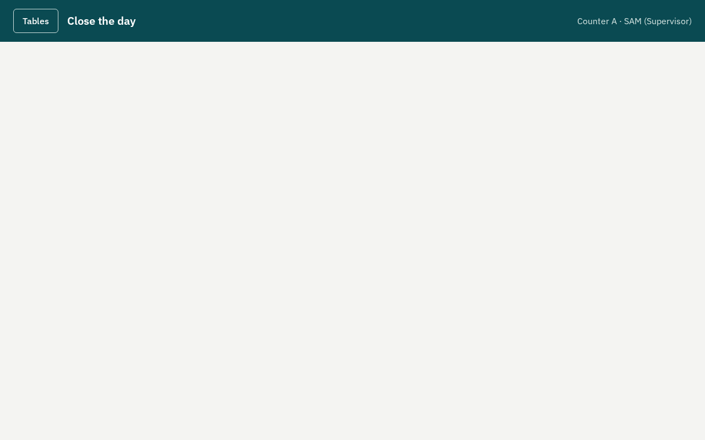

# Supervisor guide

Tausi POS at `[BUSINESS NAME]`. Supervisors approve, sign off cash-ups and close the day.

## 1. Approvals

Waiters need you for voids, gifts, reprints and price changes (what needs approval is set in
Permissions). Two ways:

- **On the spot**: on their screen, type your PIN on the pad and press **Approve**. Your own PIN never
  approves your own request.
- **From your counter**: requests arrive with a chime and a number on **Approvals**. Open it, read what is
  asked (table, item, reason, who asked), and press **Approve** or **Reject**. If two supervisors press at
  once, it happens only once.

For a void, tick whether the drink was **already poured**: poured drinks count as stock loss, the rest
go back to stock.

## 2. Voids and gifts

- **Void**: a printed item that shouldn't be paid for (wrong item, spilled). A VOID slip goes to the
  counter and a corrected bill prints.
- **Gift**: an item on the house. It stays on the bill at 0 and is reported as a gift.
- **Discount** and **price change**: on the ticket's **+** menu, with a reason.

Every approval is logged with who asked, who approved, and when (Reports → Voids, gifts and approvals).

## 3. Signing off a cash-up

At the end of a cashier's shift they press **Close shift**; you type your PIN to sign it off. Check
the counted cash against the expected amount first: the difference is recorded under the cashier's name.

## 4. Close the day

Press **Close day** on the table map. The day closes only when:

- **every ticket is settled** (or emptied by voids). The screen lists the open ones with their waiter:
  get them settled first;
- **every cashier's shift is closed** and signed off.

Requests still waiting expire when the day closes. When **Nothing blocks the close**, the screen shows
the day: gross sales, discounts, gifts, voids, VAT, what was taken by type, pay-outs and the net. Press
**Close day** and confirm. The **day report** (the Z report) prints there, and every terminal logs out
60 seconds later. Every sale belongs to exactly one day.

## 5. Open the day

In the morning, **Open day** on the table map (a banner says when the day isn't open). Waiters can't
start tickets until it is.

## If something goes wrong

- A terminal shows **"Not connected"** for more than 5 minutes: follow "If Tausi POS is down" in the
  pilot plan, and call NexaGen.
- A printer keeps failing: on the admin site, Terminals and printers → the printer → send its jobs to
  another printer.
