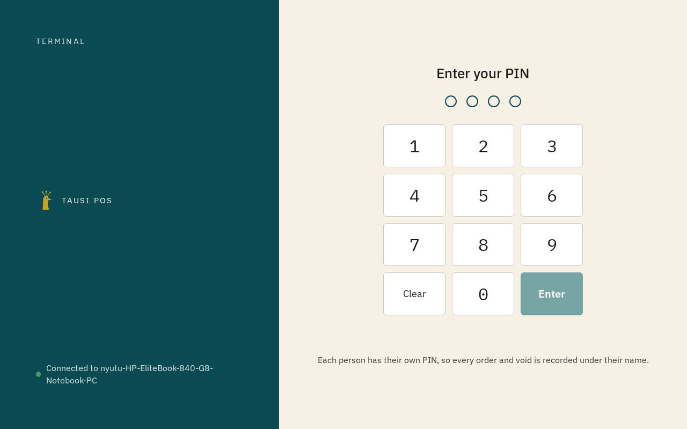
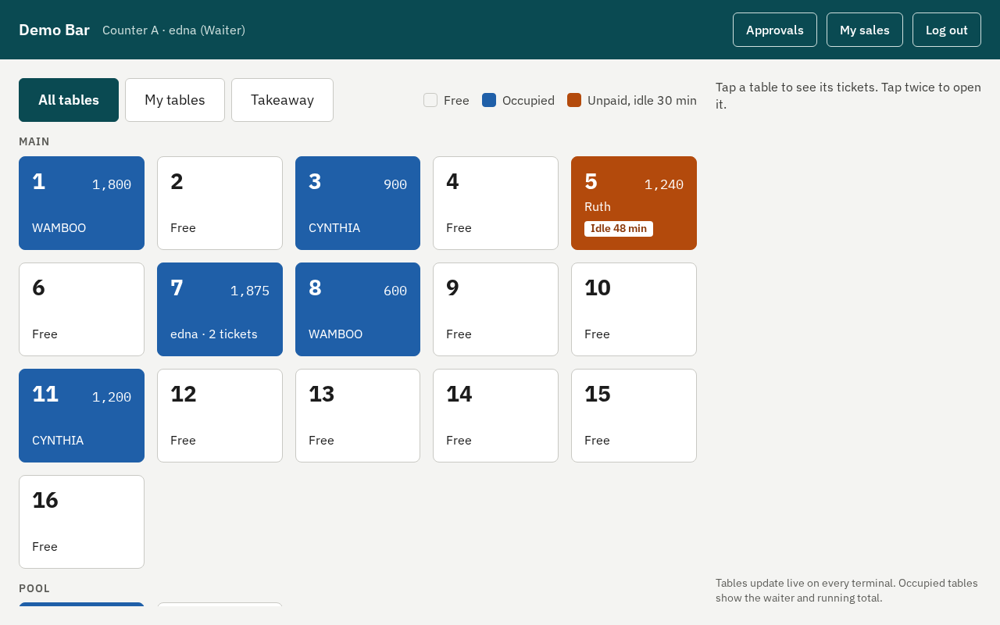
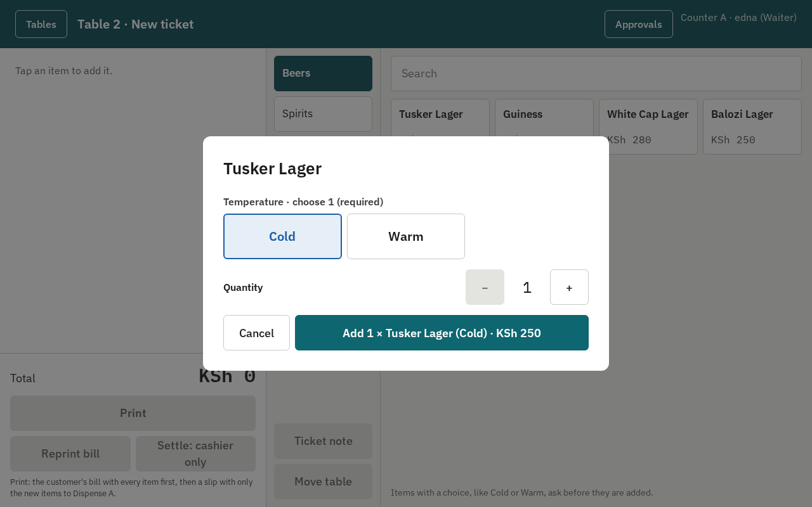
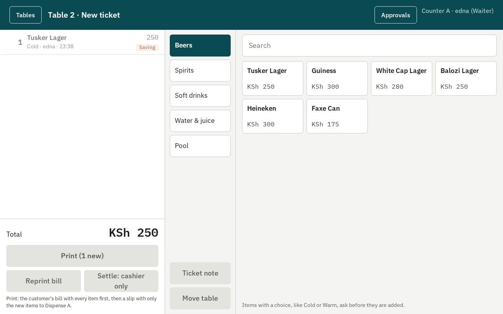
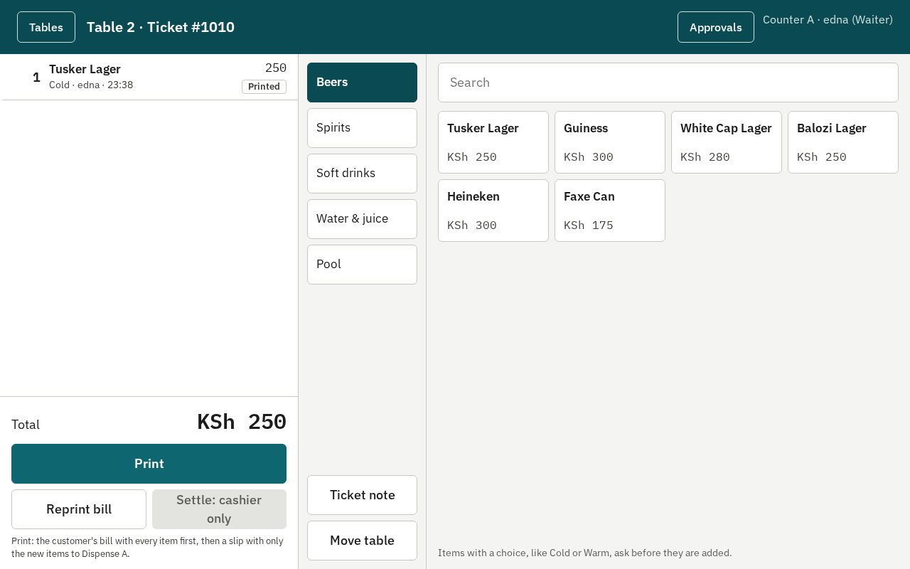
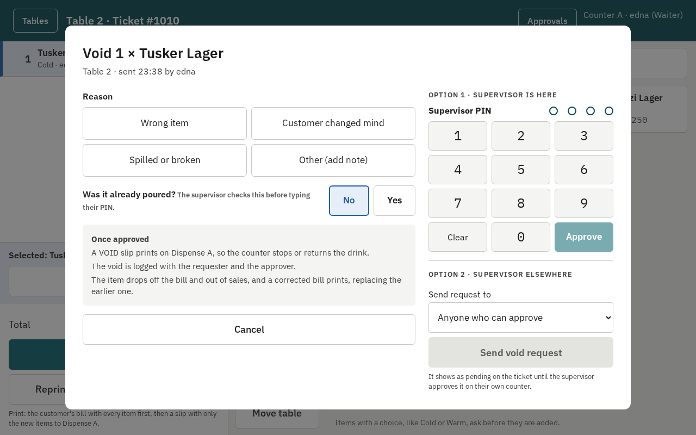
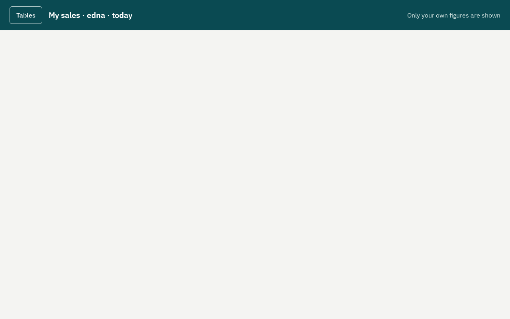

# Waiter guide

Tausi POS at `[BUSINESS NAME]`. Keep this by the counter.

## 1. Log in

Type **your own PIN** on the pad. Every item you add and every void is recorded under your name, so
never use someone else's PIN. To leave, press **Log out** (top right). The screen also logs you out by
itself after a few minutes without use.

## 2. The tables

- **White**: free. **Blue**: open, with the waiter and the running total. **Orange**: not paid and idle for
  a while. Go and check on it.
- Tap a table to see its tickets; tap it again to open it. A free table opens a new ticket.
- **My tables** shows only yours; **Takeaway** is for customers without a table.

## 3. Take the order

Choose a category on the left, then tap an item. A drink with a choice asks first: **Cold or Warm**.
Pick one, set the quantity, and press **Add**.

New items show **New** until they are printed. Tap a line to change its quantity or remove it while it
is still new.

## 4. Print

Press **Print**. It does two things, in this order:

1. The **customer's bill**, with **every** item on the ticket and the total. Take it to the table.
2. A **slip for the counter** with **only the new items**, so the barman pours just those.

For the next round, add the new items and press **Print** again: a new full bill, and a slip with only
the new round. Items left as **New** have not gone to the counter: press Print before you walk away.

## 5. A mistake after printing: Void

Tap the printed line, then **Void**. Choose the reason and say whether it was already poured. Then:

- **Supervisor here?** They type their PIN on the pad and press **Approve**.
- **Supervisor elsewhere?** Press **Send void request**. It waits on the ticket until they approve it on
  their own counter.

A VOID slip goes to the counter and a corrected bill prints by itself.

## 6. Getting paid

Only the **cashier** settles. Take the cash or show the M-Pesa message to the cashier; they record that
you brought it.

## 7. My sales

**My sales** (top of the tables screen) shows your sales today, the money you brought to the cashier,
and **any bills still open on your name**. Check it before you go home; you can print your slip.

## If something goes wrong

- **"Not connected"** at the top: wait; it reconnects by itself. If an item says *was not added*, add it
  again when the banner goes.
- **"Not printed · Retry"**: press **Retry**. If it fails again, tell the supervisor.
